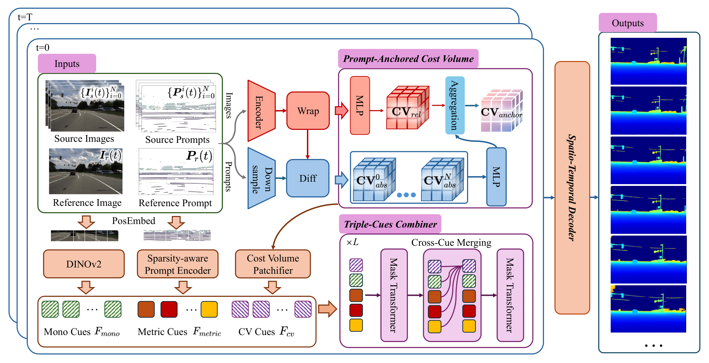
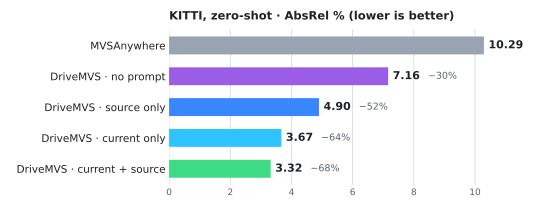

<p align="center">
  
</p>

<h1 align="center">DriveMVS</h1>

<p align="center">
  <b>LiDAR Prompted Spatio-Temporal Multi-View Stereo for Autonomous Driving</b>
</p>

<p align="center">
  Qihao Sun<sup>1,2,†</sup> · Jiarun Liu<sup>1,†</sup> · Ziqian Ni<sup>1,†</sup> · Jianyun Xu<sup>1</sup> ·
  Tao Xie<sup>2</sup> · Lijun Zhao<sup>2</sup> · Ruifeng Li<sup>2,✉</sup> · Sheng Yang<sup>1,✉</sup>
  <br>
  <sup>1</sup>Unmanned Vehicle Dept., CaiNiao Inc., Alibaba Group &nbsp;&nbsp; <sup>2</sup>Harbin Institute of Technology
  <br>
  <sub>† equal contribution &nbsp; ✉ corresponding authors</sub>
</p>

<p align="center">
  <a href="https://arxiv.org/abs/2603.03765"></a>
  
  
  
  
</p>

<p align="center">
  <a href="#-highlights">Highlights</a> ·
  <a href="#-results">Results</a> ·
  <a href="#-setup">Setup</a> ·
  <a href="#-data">Data</a> ·
  <a href="#-evaluation">Evaluation</a> ·
  <a href="#-training">Training</a> ·
  <a href="#-implementation-notes">Notes</a> ·
  <a href="#-citation">Citation</a>
</p>

<br>

> **DriveMVS** is a multi-view stereo network for driving scenes. It takes a
> short clip of posed images and, optionally, **sparse LiDAR depth as a
> prompt**, and predicts metric depth that is accurate, stable over time, and
> still reliable when the prompt is missing.

##  Highlights

<table>
  <tr>
    <td align="center" width="25%"><br><b>LiDAR really helps</b></td>
    <td align="center" width="25%"><br><b>Borrows LiDAR from neighbours</b></td>
    <td align="center" width="25%"><br><b>Fine with no prompt</b></td>
    <td align="center" width="25%"><br><b>Stable over time</b></td>
  </tr>
  <tr>
    <td valign="top">Sparse depth anchors the cost volume, guides the cost-volume encoder and corrects the output scale.</td>
    <td valign="top">Prompts of the <i>source</i> frames are moved into the reference view with the known poses, so a frame without its own LiDAR still benefits.</td>
    <td valign="top">Every prompt pathway is a residual that starts at zero, and training randomly drops prompts.</td>
    <td valign="top">A spatio-temporal DPT head with temporal attention, trained on clips with a temporal gradient loss.</td>
  </tr>
  <tr>
    <td align="center"><code>10.3 → 3.3</code><br><sub>AbsRel % on KITTI</sub></td>
    <td align="center"><code>10.3 → 4.9</code><br><sub>current frame without LiDAR</sub></td>
    <td align="center"><code>10.3 → 7.2</code><br><sub>no LiDAR anywhere</sub></td>
    <td align="center"><code>3.3 → 2.5</code><br><sub>temporal alignment error %</sub></td>
  </tr>
</table>

<sub>Numbers: zero-shot on KITTI, MVSAnywhere → DriveMVS. See <a href="#-results">Results</a> for the full tables and caveats.</sub>

Other things you get:

- 🎯 **No ground truth at test time** — the depth range comes from the prompts, or from camera baselines when there are none.
- 🧪 **Four evaluation modes** — `both`, `cur_only`, `src_only`, `none` — so every claim above can be checked separately.
- ⏱️ **A corrected temporal metric** (TAE) with optional occlusion tolerance.
- 🧩 **Small footprint** on top of [MVSAnywhere](https://github.com/nianticlabs/mvsanywhere): new code lives in a handful of clearly marked files.

> [!IMPORTANT]
> **Project status.** This repository is a cleaned-up re-implementation of the
> method. The checkpoints used for the arXiv v1 numbers are no longer
> available, and several components were redesigned while preparing the
> release (see [Implementation notes](#-implementation-notes)). Numbers below
> come from this code base and **differ from the tables in arXiv v1**.

###  Roadmap

- [x] Training and evaluation code
- [x] Data pipelines for KITTI, Virtual KITTI 2 and MVS-Synth
- [x] Four prompt modes, ground-truth-free depth range, corrected TAE
- [ ] Pretrained checkpoints
- [ ] Larger training set (TartanAir, real driving data)
- [ ] DDAD and Waymo evaluation
- [ ] Sliding-window inference for long sequences
- [ ] Ablations of each prompt pathway and of the temporal head

##  Method at a glance

<p align="center">
  
</p>

<sub><b>Overview</b> (figure from the paper). Sparse LiDAR prompts anchor the multi-view cost volume, are fused with
monocular and cost-volume cues, and a spatio-temporal decoder produces consistent depth for the whole clip. Some
blocks are implemented differently in this release; see <a href="#-implementation-notes">Implementation notes</a>.</sub>

| Prompt mode | Current frame has LiDAR | Source frames have LiDAR |
|:--|:-:|:-:|
| `both` | ✅ | ✅ |
| `cur_only` | ✅ | ❌ |
| `src_only` | ❌ | ✅ |
| `none` | ❌ | ❌ |

##  Results

All numbers are from this code base. The model is **trained on synthetic data
only** (Virtual KITTI 2 + MVS-Synth, 4,000 updates on 8 GPUs, initialised from
MVSAnywhere) — it has never seen KITTI. The baseline is the public
MVSAnywhere checkpoint, run through the same pipeline.

<p align="center">
  <picture>
    <source media="(prefers-color-scheme: dark)" srcset="assets/results_kitti_dark.svg">
    
  </picture>
</p>

**KITTI** — 566 clips / 3,396 frames, zero-shot, 32 LiDAR lines as prompt, ground-truth-free depth range.

| Model | Prompt mode | MAE (m) ↓ | AbsRel (%) ↓ | τ<1.25 (%) ↑ | TAE (%) ↓ |
|:--|:--|--:|--:|--:|--:|
| MVSAnywhere | – | 1.751 | 10.29 | 91.2 | 3.32 |
| DriveMVS | `none` | 1.353 | 7.16 | 94.9 | 3.02 |
| DriveMVS | `src_only` | 1.004 | 4.90 | 97.2 | 2.47 |
| DriveMVS | `cur_only` | 0.800 | 3.67 | 98.1 | 2.54 |
| DriveMVS | `both` | **0.680** | **3.32** | **98.4** | **2.46** |

<details>
<summary>📉 Fewer LiDAR lines (KITTI, <code>both</code>)</summary>

| LiDAR lines | MAE (m) ↓ | AbsRel (%) ↓ | τ<1.25 (%) ↑ | TAE (%) ↓ |
|--:|--:|--:|--:|--:|
| 32 | 0.680 | 3.32 | 98.4 | 2.46 |
| 16 | 0.813 | 3.81 | 98.1 | 2.53 |
| 8 | 0.983 | 4.51 | 97.6 | 2.63 |

</details>

<details>
<summary>🏙️ Virtual KITTI 2 (Scene18, 112 clips, 16 simulated lines)</summary>

| Model | Prompt mode | MAE (m) ↓ | AbsRel (%) ↓ | τ<1.25 (%) ↑ | TAE (%) ↓ |
|:--|:--|--:|--:|--:|--:|
| MVSAnywhere | – | 3.479 | 11.12 | 85.8 | 3.30 |
| DriveMVS | `none` | 3.161 | 8.64 | 91.1 | 2.78 |
| DriveMVS | `src_only` | 2.301 | 7.71 | 93.5 | 2.57 |
| DriveMVS | `cur_only` | 2.298 | 7.35 | 93.4 | 2.77 |
| DriveMVS | `both` | **2.226** | **7.31** | **93.6** | 2.62 |

</details>

<details>
<summary>⚠️ How to read these numbers</summary>

- TAE is the occlusion-tolerant variant (`tae_tol` in the evaluation output).
- The MVSAnywhere baseline was not retrained with our recipe, so part of the
  `none` improvement comes from the training augmentations rather than the
  architecture.
- The lower TAE has not yet been separated from the gain in accuracy; an
  ablation without the temporal head is on the roadmap.
- Source prompts are trusted as much as current ones. When the source frames
  are several seconds old (e.g. a car waiting at a junction), pose drift makes
  the transferred prompts biased and `src_only` can fall behind `none`.
- Results come from a single training run.

</details>

##  Setup

```shell
git clone https://github.com/Akina2001/DriveMVS.git
cd DriveMVS

python -m venv .venv && source .venv/bin/activate      # Python 3.12
pip install -r requirements.txt
export PYTHONPATH=src
export OPENCV_IO_ENABLE_OPENEXR=1                      # MVS-Synth depth is stored as EXR
```

> [!NOTE]
> Two pins matter: `kornia==0.6.7` (newer versions break a scripted pyramid
> op) and OpenCV 4.x (5.x cannot read EXR).

**Weights to initialise training** go into `weights/`:

| File | Used for | Source |
|:--|:--|:--|
| `mvsanywhere_hero.ckpt` | initialisation and baseline | [MVSAnywhere](https://github.com/nianticlabs/mvsanywhere#-pretrained-models) |
| `video_depth_anything_vitb.pth` | temporal attention layers | [Video Depth Anything (ViT-B)](https://huggingface.co/depth-anything/Video-Depth-Anything-Base) |

DINOv2 is loaded through `torch.hub`. To work offline, clone
[facebookresearch/dinov2](https://github.com/facebookresearch/dinov2) and set
`DINOV2_REPO=/path/to/dinov2`.

##  Data

Datasets are expected under `data/` (symlinks are fine). The frame tuples and
clip lists we use are shipped in `data_splits/drivemvs/`.

| Dataset | Role | Prompt | Where |
|:--|:--|:--|:--|
| 🏙️ Virtual KITTI 2 | train / val | simulated scan lines | [download](https://europe.naverlabs.com/research/computer-vision/proxy-virtual-worlds-vkitti-2/) (`rgb`, `depth`, `textgt`) |
| 🎮 MVS-Synth | train / val | simulated scan lines | [download](https://phuang17.github.io/DeepMVS/mvs-synth.html) (`GTAV_540`) |
| 🚗 KITTI | zero-shot test | real Velodyne | [raw data](https://www.cvlibs.net/datasets/kitti/raw_data.php) + [depth completion](https://www.cvlibs.net/datasets/kitti/eval_depth.php?benchmark=depth_completion) |

<details>
<summary>📁 Expected folder layout</summary>

```
data/
├── vkitti2/
│   └── Scene01/clone/frames/{rgb,depth}/Camera_0/...      + extrinsic.txt, intrinsic.txt
├── mvssynth/                                              (the GTAV_540 folder)
│   └── 0000/{images,depths,poses}/...
└── kitti/
    ├── raw_data/2011_09_26/2011_09_26_drive_0002_sync/{image_02,oxts}/...
    ├── raw_data/2011_09_26/calib_*.txt
    ├── val/2011_09_26_drive_0002_sync/proj_depth/{groundtruth,velodyne_raw}/image_02/...
    └── drivemvs_meta/...                                  (written by prepare_kitti.py)
```

</details>

**KITTI poses and intrinsics** are derived from the official OXTS trajectory and calibration:

```shell
python tools/data/prepare_kitti.py --kitti_root data/kitti \
    --scans data_splits/drivemvs/kitti/val_scans.txt
```

**Clip lists** group consecutive frame tuples into clips of 6 frames. To build your own from a per-frame tuple file:

```shell
python tools/data/make_clip_tuples.py \
    --input  data_splits/drivemvs/kitti/val_eight_view_deepvmvs.txt \
    --output data_splits/drivemvs/kitti/val_eight_view_deepvmvs_clip6.txt
```

##  Evaluation

Evaluate a DriveMVS checkpoint on KITTI in all four prompt modes:

```shell
python tools/evaluate.py \
    --config_file configs/drivemvs/drivemvs_vitb.yaml \
    --data_config_file configs/drivemvs/kitti_val.yaml \
    --load_weights_from_checkpoint path/to/drivemvs.ckpt \
    --eval_prompt_mode all \
    --eval_output_json results/kitti.json
```

The MVSAnywhere baseline through the same pipeline:

```shell
python tools/evaluate.py \
    --config_file configs/drivemvs/mvsanywhere_baseline.yaml \
    --data_config_file configs/drivemvs/kitti_val.yaml \
    --load_weights_from_checkpoint weights/mvsanywhere_hero.ckpt \
    --eval_output_json results/kitti_mvsanywhere.json
```

Useful switches:

| Option | Meaning |
|:--|:--|
| `--eval_prompt_mode` | `all`, or one of `both`, `cur_only`, `src_only`, `none` |
| `--lidar_keep_every N` | keep every N-th of 64 LiDAR lines (2 → 32 lines, 4 → 16, 8 → 8) |
| `--prompt_eval_num_lines N` | number of simulated lines on synthetic data |
| `--depth_range_mode` | `auto` (default), `prompt`, `heuristic`, or `gt` |
| `--eval_max_clips N` | quick run on an evenly spaced subset |

The script reports MAE, AbsRel, τ<1.25, the same metrics on pixels away from
any prompt (`*_np`), and the temporal alignment error with and without
occlusion tolerance (`tae_tol`, `tae`), overall and per sequence.

##  Training

```shell
python src/mvsanywhere/train.py \
    --config_file configs/drivemvs/drivemvs_vitb.yaml \
    --data_config_file configs/drivemvs/vkitti2_train.yaml:configs/drivemvs/mvssynth_train.yaml \
    --val_data_config_file configs/drivemvs/vkitti2_val.yaml:configs/drivemvs/mvssynth_val.yaml \
    --lazy_load_weights_from_checkpoint weights/mvsanywhere_hero.ckpt \
    --temporal_weights_path weights/video_depth_anything_vitb.pth \
    --log_dir runs --name drivemvs_vitb
```

The default config trains on 8 GPUs with one clip of 6 frames per GPU, mixed
precision and gradient accumulation of 2; 4,000 updates take about 3.5 hours
on A100s. What happens during training:

- 🎲 **Prompt modes** are sampled per clip (`--prompt_mode_probs`, default 40 % `both`, 20 % each of the others).
- 🌫️ **Prompt augmentation**: depth noise, dropped points, outliers, random range cut.
- 🧊 **Stereo-failure augmentation**: some clips get static source frames or a wrong pose scale, so the network learns to rely on the prompt when matching fails.
- 📏 **Depth range** is drawn from the ground truth or estimated as at test time, half of the time each.

Run the unit tests with `pytest tests/`.

##  Implementation notes

While preparing this release we compared the saved research code with the
arXiv v1 text and redesigned the parts that did not hold up. In short:

| Topic | arXiv v1 | This repository |
|:--|:--|:--|
| Source-frame prompts in the cost volume | used without bringing them to the reference view | moved into the reference view with the known poses |
| Token fusion ("triple-cue combiner") | described with cross-attention | masked, zero-initialised additive fusion of prompt tokens |
| Scale correction | – | new output-space **prompt refiner**; in our experiments it carries most of the LiDAR gain |
| Temporal decoder | pose-aware spatio-temporal decoder | Video-Depth-Anything-style DPT head with temporal attention |
| Missing prompts | – | explicit prompt modes in training and evaluation |
| Depth range at test time | taken from the ground truth | from prompts, or camera baselines |
| TAE metric | – | reprojection convention and invalid pixels fixed, occlusion tolerance added |
| KITTI prompt density | 16 lines | 32 lines by default, 16 and 8 reported |
| MVS-Synth intrinsics | – | read at the native image size (the upstream loader assumed a fixed width) |

##  Repository layout

```
configs/drivemvs/                 model and dataset configs
data_splits/drivemvs/             scan lists, frame tuples and clip lists
tools/evaluate.py                 evaluation with prompt modes and TAE
tools/data/                       KITTI preparation, clip list generation
src/mvsanywhere/
├── utils/prompt_utils.py         LiDAR simulation, prompt transfer, prompt modes
├── utils/temporal_metrics.py     temporal alignment error
├── modules/prompt_encoder.py     sparsity-aware prompt tokens
├── modules/prompt_refiner.py     output-space prompt refiner
├── modules/depth_anything_blocks.py   temporal DPT head
├── modules/motion_module/        temporal attention blocks
├── datasets/{kitti,vkitti,mvssynth}.py
└── experiment_modules/sr_depth_model.py   model, losses, training step
```

Files added by DriveMVS say so in their header; everything else is upstream
MVSAnywhere. Its original README (demos, other datasets, Gaussian splatting)
is kept as [docs/MVSANYWHERE_README.md](docs/MVSANYWHERE_README.md).

##  Citation

```bibtex
@article{sun2026drivemvs,
  title   = {LiDAR Prompted Spatio-Temporal Multi-View Stereo for Autonomous Driving},
  author  = {Sun, Qihao and Liu, Jiarun and Ni, Ziqian and Xu, Jianyun and Xie, Tao and Zhao, Lijun and Li, Ruifeng and Yang, Sheng},
  journal = {arXiv preprint arXiv:2603.03765},
  year    = {2026}
}
```

Please also cite the work this code builds on:

```bibtex
@inproceedings{izquierdo2025mvsanywhere,
  title     = {{MVSAnywhere}: Zero Shot Multi-View Stereo},
  author    = {Izquierdo, Sergio and Sayed, Mohamed and Firman, Michael and Garcia-Hernando, Guillermo and Turmukhambetov, Daniyar and Civera, Javier and Mac Aodha, Oisin and Brostow, Gabriel J. and Watson, Jamie},
  booktitle = {CVPR},
  year      = {2025}
}
```

##  Acknowledgements

- 🧱 [MVSAnywhere](https://github.com/nianticlabs/mvsanywhere) — the code base and the initial weights.
- 🎞️ [Video Depth Anything](https://github.com/DepthAnything/Video-Depth-Anything) — temporal head design and temporal gradient matching loss.
- 🌀 [AnimateDiff](https://github.com/guoyww/AnimateDiff) — motion module blocks.
- 🦖 [DINOv2](https://github.com/facebookresearch/dinov2) — image encoder.
- 🗂️ [DeepVideoMVS](https://github.com/ardaduz/deep-video-mvs) — keyframe selection used for the frame tuples.
- 🚗 KITTI, Virtual KITTI 2 and MVS-Synth — data.

##  License

This repository is derived from MVSAnywhere (Copyright © Niantic, Inc.) and is
released under the same **non-commercial** license; see [LICENSE](LICENSE).
Third-party components keep their own licenses.

<p align="center">
  &nbsp;&nbsp;&nbsp;
</p>
